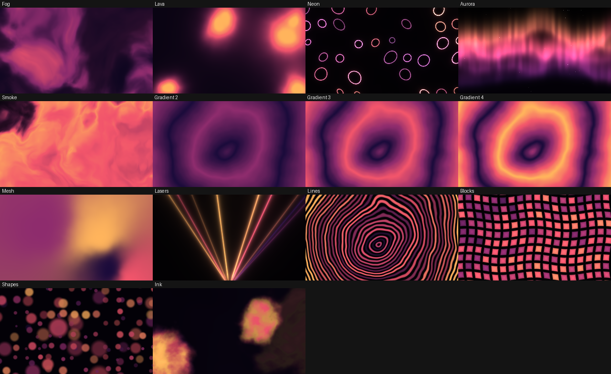

# Background Gen — Souz Content

**Novo: painel web incorporado à DLL, botão Abrir painel e controle Speed pelo navegador.** Comece por [PAINEL_SOUZ.md](PAINEL_SOUZ.md) para compilar e fazer o primeiro teste. A descrição original do gerador está abaixo.

Veja [VALIDACAO.md](VALIDACAO.md) para distinguir os testes executados aqui dos testes pendentes no Windows/Resolume.

Plugin **FFGL 2.x** do tipo *Source*. Não toca vídeo: todo o visual é gerado em tempo real por **um shader GLSL na GPU**, então aparece no Resolume em **Sources → FFGL → Background Gen** como qualquer gerador.



## Parâmetros (ordem = ordem na interface do Resolume)

| Parâmetro | O que faz |
|---|---|
| **Engine** | Fog (névoa), Lava, Neon, Aurora, Smoke (fumaça), Gradient 2 / 3 / 4 cores, Mesh (gradiente de 4 manchas), Lasers, Lines, Blocks, Shapes, Ink (tinta na água) |
| **Shape** | Circle, Square, Triangle, Hexagon, Star, Diamond, Cross, Ring, Pill, Heart + (só para gradientes/linhas) Linear, Angular, Spiral, Wave |
| **Palette** | `Custom` (usa Color 1–4) + 31 paletas prontas |
| **Scale** | Tamanho das estruturas (zoom) |
| **Density** | Quantidade: cobertura da névoa, nº de blobs/raios/formas/gotas, resolução da grade, nº de faixas… |
| **Smoothness** | 0 = bordas duras e cores em degraus (posterizado) → 1 = tudo macio |
| **Blur** | Desfoque: remove detalhe fino, alarga brilho/glow e bordas |
| **Speed** | Velocidade (0–4×, curva quadrática). Mudar não dá "pulo" na animação |
| **Warp** | Distorção orgânica / turbulência |
| **Seed** | 10 000 "sementes": mesma configuração, padrão completamente diferente |
| **Rotation** | Gira todo o padrão |
| **Brightness / Contrast / Saturation** | Acabamento final (0.5 = neutro) |
| **ColorShift** | Desliza as cores ao longo da paleta (dá para automatizar) |
| **Pulse** | Pulsa o brilho no tempo do BPM do Resolume |
| **Reverse / Invert** | Inverte o tempo / inverte as cores |
| **Color 1–4** | Cores da paleta *Custom* (seletor HSB) |

Gradient 2 usa as cores 1–2, Gradient 3 as cores 1–3, os demais usam as 4.

### Quantas variações?
14 motores × 14 formas × 32 paletas = **6 272** combinações estruturais. Na prática, a forma só muda o resultado em Gradient 2/3/4, Lines, Neon, Shapes e Blocks (≈ 85 combinações motor×forma realmente diferentes) → ≈ **2 720** visuais base × **10 000 seeds** ≈ **27 milhões**, antes de mexer em qualquer um dos ~12 sliders contínuos (Scale, Density, Smoothness, Blur, Warp, Rotation, ColorShift, …), que multiplicam isso sem limite. A meta de 1 milhão está bem coberta.

## Como gerar o .dll (Windows 64-bit)

O .dll precisa ser compilado no Windows (MSVC). Duas opções:

**A) GitHub Actions (sem instalar nada)** — suba esta pasta para um repositório no GitHub. O workflow `.github/workflows/build.yml` compila e publica o artefato **BackgroundGen-win64** (aba *Actions* → último run → *Artifacts*).

**B) Local** — com Visual Studio 2022 (workload "Desenvolvimento para desktop com C++"), CMake e Git: dê dois cliques em `build_windows.bat`. Ele baixa o SDK da Resolume, compila e já copia o .dll para `Documents\Resolume Arena\Extra Effects`.

### Instalar
Copie `BackgroundGen.dll` para `Documentos\Resolume Arena\Extra Effects` (ou a pasta definida em *Preferences → Video → Extra Effects*) e reinicie o Resolume. Precisa do Resolume **7.3.1+** (64-bit).

## Estrutura do projeto

```
shader/00_common.glsl     hash, ruído, fbm, SDFs das formas, paleta
shader/10_engines.glsl    uma função por motor (eng_fog, eng_lava, …)
shader/90_main.glsl       leitura dos parâmetros, escolha do motor, acabamento
tools/gen_shader.py       FONTE ÚNICA: listas de motores/formas/paletas/parâmetros.
                          Gera src/ShaderSource.h + src/ParamsGenerated.inc
src/BackgroundGen.cpp/.h  classe do plugin (tempo integrado p/ Speed e Reverse)
tools/preview.py          renderiza o shader sem GPU (Mesa) -> PNGs de teste
tools/sweep.py            varredura de extremos de todos os parâmetros
CMakeLists.txt, build_windows.bat, .github/workflows/build.yml
```

### Como estender
* **Nova paleta / forma / motor**: edite as listas no topo de `tools/gen_shader.py` (e, para motor/forma, a função GLSL correspondente), rode `python tools/gen_shader.py` e recompile. O C++ e o GLSL nunca saem de sincronia porque ambos são gerados da mesma tabela.
* **Novo parâmetro**: adicione uma linha em `PARAMS` no mesmo script e use o nome como uniform no GLSL.
* **Testar visual sem Resolume** (Linux + Mesa): `python tools/preview.py sheet out.png` · `python tools/preview.py one out.png Engine=3 Palette=2 Seed=0.4`.

## O que foi e não foi testado
Testado aqui: o shader completo compila e valida (glslang, GLSL 4.10 core) e foi **renderizado** em Mesa/llvmpipe nos 14 motores, 14 formas e 32 paletas, com uma varredura de 1 162 quadros em extremos (0 e 1 de cada slider, vários seeds e tempos) sem NaN nem quadros pretos/estourados; o plugin C++ compila contra o SDK da Resolume e o framework gera exatamente os uniforms esperados.
**Não testado:** a compilação MSVC do .dll e o carregamento dentro do Resolume (não há Windows/Resolume neste ambiente). Se algo falhar no primeiro build ou na primeira carga, mande a mensagem de erro que eu ajusto.
